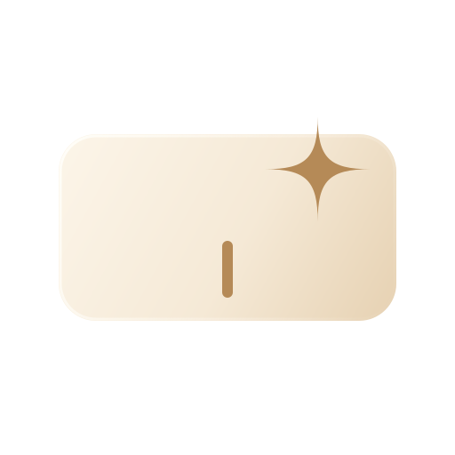

<p align="center">
  
</p>

<h1 align="center">Utochpad</h1>

<p align="center">
  <strong>把 Android 手机变成 Windows 的指纹解锁器和精密触控板。</strong>
</p>

<p align="center">
  锁屏时，它是你的指纹；回到桌面，它是一块真正的 Precision Touchpad，外加一枚 Surface Dial。
</p>

<p align="center">
  <a href="#为什么是-utochpad">为什么是 Utochpad</a> ·
  <a href="#快速开始">快速开始</a> ·
  <a href="#使用">使用</a> ·
  <a href="docs/architecture.md">工作原理</a> ·
  <a href="docs/building.md">从源码构建</a> ·
  <a href="docs/troubleshooting.md">故障排查</a>
</p>

---

## 这是什么

Utochpad 由两部分组成：一个 Windows 服务和驱动组件，以及一个 Android 应用。手机与电脑在同一局域网内直连，电脑端不需要任何手机厂商的客户端、云账号或互联网连接。

它把手机接入了 Windows 最底层的输入路径：

- **指纹解锁**——锁屏界面上出现 Utochpad 磁贴，点击后手机弹出指纹，验证通过即完成登录。
- **精密触控板**——手机横屏后整屏就是触控板。每一根手指的原始触点都被原样交给 Windows，双指滚动、捏合、三指切换桌面等手势全部由 Windows 自己识别。
- **Surface Dial**——屏幕右侧的旋钮作为 Windows Radial 控制器使用，可调音量、画笔大小或任意支持 Radial 的应用。

触控板和旋钮可以同时使用，因为它们在 Windows 眼里就是两块插在 USB 总线上的真实设备。

## 为什么是 Utochpad

| | |
| --- | --- |
| 🔐 **密码只留在手机** | Windows 密码用指纹密钥加密保存，电脑端不落盘；没有你的指纹，密码无法被取出。 |
| 🖐 **不是模拟手势，是真实触控板** | 手机发送标准 PTP 报文，Windows 把它当作精密触控板。手势能力与实体触控板一致，而不是在 App 里猜手势。 |
| 🎛 **真的能用 Surface Dial** | 基于 Windows Radial Controller 协议，不是自定义快捷键。 |
| 🔒 **端到端加密** | ECDH 配对、AES-256-GCM 会话加密、严格计数器，局域网内也不裸奔。 |
| 🧩 **无需 root，无需刷机** | 手机端就是普通 APK；电脑端通过 VIIPER + usbip-win2 提供虚拟 USB 设备。 |
| 🇨🇳 **中文安装向导** | 自动安装服务、凭据提供程序、防火墙规则，并提示缺失的系统组件。 |

## 快速开始

### 准备

- Windows 11 x64（安装与解锁需要管理员/系统权限）
- Android 8.1（API 27）及以上，已录入指纹
- 手机与电脑处于同一局域网，路由器未开启 AP 隔离

> 触控板与旋钮需要电脑安装 [usbip-win2](https://github.com/vadimgrn/usbip-win2) 驱动；解锁功能需要 .NET 10 Runtime。安装包会检测并提示。

### 安装

在仓库根目录运行：

```powershell
.\Windows\installer\build-installer.ps1
```

生成的 `artifacts\installer\Utochpad-Setup-<version>.exe` 是带中文向导的安装包。运行它会注册服务、凭据提供程序和控制面板。

开发机上也可以直接用脚本安装：

```powershell
.\Windows\installer\build-viiper.ps1
.\Windows\installer\install.ps1
```

详细的构建要求、参数和 Android APK 构建方式见 [docs/building.md](docs/building.md)。

### 配对

1. 打开开始菜单里的 **Utochpad** 控制面板，确认服务状态正常。
2. 点击 **开始配对**，用手机 App 扫描二维码（扫不了也可以粘贴配对码）。
3. 配对成功后，在面板中输入当前 Windows 账户的**密码**并发送；手机验证指纹后保存。

### 解锁与输入

1. 按 `Win+L` 锁定 Windows，点击锁屏上的 **Utochpad** 磁贴。
2. 手机 App 保持前台，指纹通过后自动登录。
3. 回到桌面，手机会自动连接并转为横屏，直接进入触控板页面。

## 使用

**触控板**

- 单指移动，双指滚动/捏合，三指及以上手势交给 Windows。
- 没有左/右键实体按键：点击由 Windows 从触点流中识别，和实体触控板一致。
- 声明的物理表面约为横屏手机的 **6.40 × 3.00 英寸**。

**旋钮**

- 位于屏幕右侧、上下居中。
- 按住即按下 Radial 按钮，绕中心旋转调节，松开确认。

**设置**

- 右上角“设置”打开独立设置页；打开或返回设置页不会断开电脑连接。
- 手机 App **必须保持前台**。锁屏或切到后台会断开会话——这是 Android 生物识别提示的限制，也是本设计的安全前提。

## 控制面板

控制面板是 Utochpad 在 Windows 上的桌面入口，也是 C# 服务的本地管理客户端。它不参与解锁，负责：

- **配对手机**：显示配对与连接状态，生成二维码和手动配对码，可复制、取消或重新配对。
- **Windows 密码**：通过命名管道把密码发送到手机，等待手机指纹确认。
- **维护**：查看服务与输入组件状态、端口、地址、数据目录与日志目录，重启输入组件或解除配对。
- **关于**：查看应用说明与控制面板、后台服务版本。

面板使用 Tauri 2 + Vue 3 实现，开发与构建方式见 [docs/building.md](docs/building.md)；与服务的管道协议见 [docs/architecture.md](docs/architecture.md)。

## 安全

- 局域网内的所有业务数据都用 **AES-256-GCM** 加密；配对使用 ECDH 与双向 HMAC 证明。
- Windows 密码**只在手机**保存：密码由随机 PDK 加密，PDK 由 Android Keystore 中的指纹密钥包裹。
- 电脑端不持久化密码；凭据提供程序只在内存中以 `SecureString` 交给 Windows。
- 配对 token 一次性、5 分钟有效；手机校验服务公钥，防止连到假服务器。
- 未配对的设备无法建立会话；服务只接受活动控制台会话的解锁请求。

完整的安全模型与边界见 [docs/security.md](docs/security.md)。

## 工作原理

```
┌──────────── Android ────────────┐          ┌──────────────────── Windows ────────────────────┐
│                                 │          │                                                 │
│  指纹解锁 / 触控板 / Surface Dial │◄─ Wi-Fi ─►│  UtochpadService (SYSTEM)                       │
│                                 │ WebSocket│    ├─ 凭据提供程序 (LogonUI)                      │
└─────────────────────────────────┘  加密帧   │    ├─ 控制面板 (Tauri)                           │
                                             │    └─ VIIPER ──► 虚拟 USB 总线 ──► PTP + Radial  │
                                             └─────────────────────────────────────────────────┘
```

Windows 看到的是两块标准 USB 设备，因此所有手势、Radial 交互都走 Windows 原生栈，而不是在应用层模拟。协议细节、HID 报告描述符和时序设计见 [docs/architecture.md](docs/architecture.md)。

## 项目结构

```
utouchpad/
├─ Android/       # Compose 手机应用：配对、指纹解锁、触控板 + Radial
├─ Windows/
│  ├─ Service/    # C# 服务、凭据提供程序、共享协议
│  ├─ panel/      # Tauri 2 + Vue 3 控制面板
│  ├─ installer/  # 安装包与构建脚本
│  └─ viiper/     # VIIPER 的 ptp / radial 设备覆盖层
├─ brand/         # 品牌资源
├─ docs/          # 架构、安全、构建与故障排查文档
└─ artifacts/     # 构建产物（不入库）
```

| 组件 | 技术 |
| --- | --- |
| Android 应用 | Kotlin · Jetpack Compose · Android Keystore |
| Windows 服务 | C# · .NET 10 · LocalSystem Windows 服务 |
| 凭据提供程序 | COM · Lithnet.CredentialProvider · .NET 10 |
| 控制面板 | Tauri 2 · Vue 3 · Rust |
| 虚拟 USB 设备 | Go · VIIPER · usbip-win2 |

## 从源码构建

```powershell
.\Windows\installer\build-installer.ps1                                  # 完整安装包
dotnet build Windows\Service\Utochpad.slnx -c Release -p:Platform=x64    # 仅构建 C# 侧
```

构建 VIIPER、构建控制面板、生成 Android APK、以及全部参数说明见 [docs/building.md](docs/building.md)。

## 已知限制

- 手机 App 仅在前台工作，这是 Android 生物识别与隐私限制决定的。
- 触控板手势由 Windows 解释，不同 Windows 版本的手势集合可能略有差异。
- 依赖 VIIPER 与 usbip-win2；Windows 大版本更新后如失效，优先更新这两个组件。
- 不支持多手机、多用户或公网远程访问。
- 首次配对要求手机能直接访问电脑的局域网 IP。
- 解锁需要账户**密码**（本地账户或 Microsoft 账户），Windows Hello PIN 不适用。

遇到问题先看 [docs/troubleshooting.md](docs/troubleshooting.md)；日志位于 `%ProgramData%\Utochpad\logs`。

## 第三方组件

- [VIIPER](https://github.com/Alia5/VIIPER) — 虚拟 USB 设备服务器（GPLv3）。自定义设备源码位于 `Windows/viiper/`，与固定版本的上游源码一起编译、分发。
- [Lithnet.CredentialProvider](https://github.com/lithnet/windows-credential-provider) — 凭据提供程序封装，以 git 子模块引入。
- [usbip-win2](https://github.com/vadimgrn/usbip-win2) — Windows 的 USB/IP 驱动。
- [QRCoder](https://github.com/codebude/QRCoder)、[OkHttp](https://square.github.io/okhttp/)、[ZXing Android Embedded](https://github.com/journeyapps/zxing-android-embedded)。

## 图标与版权

### 品牌与界面图标

- `brand/utochpad-logo.svg` 是 Utochpad 主标识；控制面板的应用图标由 `bun run tauri icon` 从它生成（见 [docs/building.md](docs/building.md)）。
- `brand/utouchpad_CP_icon.vectorcraft` 是凭据提供程序磁贴图标的矢量源文件。

### 凭据提供程序磁贴图标

锁屏磁贴上的图标是 `Windows/Service/Utochpad.CredentialProvider/Resources/` 下的 `TileIconWhite.png`（登录场景）与 `TileIconBlack.png`（解锁及 CredUI 场景）：256×256、32 位 ARGB 的 PNG，作为 `EmbeddedResource` 编译进 `Utochpad.CredentialProvider.dll`，由 `UtochpadCP.GetControls` 按资源名读取。

改动图标时，`Utochpad.CredentialProvider.csproj` 的 `EmbeddedResource`、`UtochpadCP.cs` 里的资源名字符串、以及矢量源文件三处要一起更新，否则运行时抛 `Failed to load embedded resource`。

**版权与许可**：磁贴图标以 Microsoft 的 [Fluent UI System Icons](https://github.com/microsoft/fluentui-system-icons) 为基础，重新组合并调整笔画与比例后栅格化。

```
Fluent UI System Icons
Copyright (c) 2020 Microsoft Corporation
Licensed under the MIT License.
```

MIT 允许商用、修改与再分发，条件是保留上述版权与许可声明；完整许可文本随安装包分发，见 `Windows/installer/THIRD-PARTY-NOTICES.txt`。MIT 只授予版权许可，不授予商标许可：Utochpad 与 Microsoft 无关联、未获其背书，`Windows`、`Surface`、`Segoe`、`Fluent` 是 Microsoft 集团公司的商标。

**设计约束**：磁贴出现在 LogonUI 上，必须与 Windows Hello 自带的指纹磁贴有明显区别，避免被误认为系统组件；图标为单色、透明背景，由 LogonUI 缩放到磁贴尺寸，256px 源图在高 DPI 下可直接降采样。